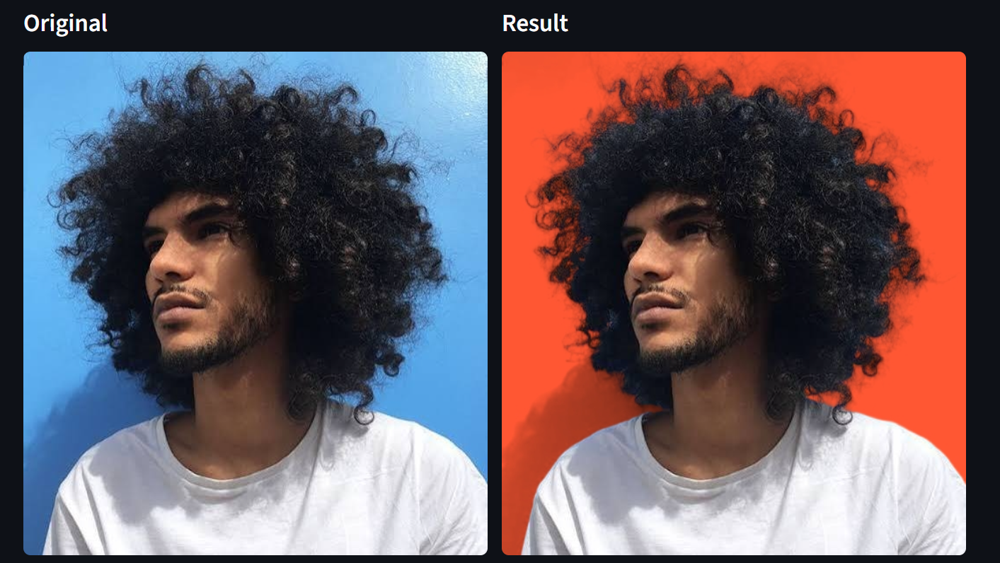
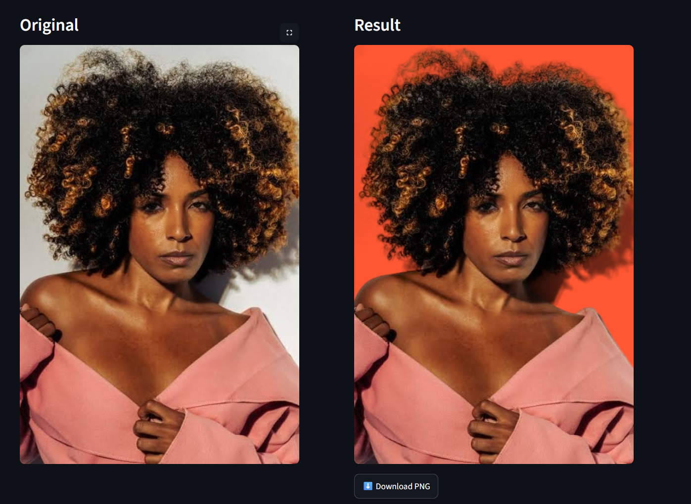

# context-swap

Put a person or product photo on a solid background colour (hex), optionally **keeping the
subject's cast shadow** rendered in the new colour.

Segmentation: [BiRefNet](https://huggingface.co/ZhengPeng7/BiRefNet). Interfaces: Streamlit app and CLI.

## Run it (one command)

```bash
pip install -r requirements.txt && streamlit run app.py
```

CLI:

```bash
python -m contextswap photo.jpg --bg "#FF5733" --keep-shadows -o out.png
```

The first BiRefNet run downloads ~900 MB of weights. On CPU use `--engine birefnet-lite`.
`--engine grabcut` needs no model (rough quality, used for tests). Tests: `pytest`.

| Option | Meaning |
|---|---|
| `--bg "#RRGGBB"` | new background colour (quote it in a shell) |
| `--keep-shadows` | recover the cast shadow and apply it on the new colour |
| `--shadow-strength 0..1` | shadow darkness (default 0.8) |
| `--bg-model uniform\|gradient` | original backdrop is flat or a gradient |
| `--shadow-threshold`, `--shadow-smooth` | noise floor / smoothing of the shadow map |
| `--shadow-hue-tolerance` | reject dark objects whose hue differs from the backdrop (0 = off) |
| `--edge-shrink N`, `--feather S`, `--no-decontaminate` | edge controls |
| `--max-side N` | working resolution cap (default 2048, 0 = none) |
| `--save-debug` | also save the alpha matte and the shadow map |

The Streamlit app also has a **manual selection tool** (magic wand / polygon) to add or remove
objects from the subject, and debug views of the matte and the shadow map.

## How it works

```
image -> BiRefNet (1024x1024) -> soft alpha -> resized to the image
              |                                   |
              v                                   v
  foreground colour estimation        shadow map from the ORIGINAL pixels outside the subject
  (pymatting: removes old-bg halo)    luminance ratio + hue test + nearest-pixel extension
              \                                   /
               out = fg*alpha + (bg_colour * (1 - strength*shadow)) * (1 - alpha)
```

## Decisions

| Decision | Why | Trade-off |
|---|---|---|
| BiRefNet via `transformers` | high-quality soft masks | heavy on CPU (lite model available) |
| Soft alpha, no hard threshold | hair, fur, fabric edges | needs decontamination |
| Edge decontamination (`pymatting`) | edge pixels still contain the old background colour (halo) | slow on large images, hence `--max-side` |
| Shadow = multiply on the new colour | "shadows keep the new colour": a darker version of the colour, not grey | invisible on near-black backgrounds |
| Shadow from luminance ratio vs. estimated backdrop | no extra model, explainable, fast | assumes a flat or planar backdrop |
| Hue test | a real shadow darkens without changing hue; a wooden stool does | tolerance too low would reject shadows on coloured walls |
| Shadow extended from the nearest background pixel | a blur left a light fringe along soft edges (curly hair) | |
| Only shadow regions touching the subject | rejects texture blobs | a detached shadow is dropped |
| Manual selection in the UI | the model's idea of "subject" is not always the user's | UI only, not in the CLI |
| Working size capped at 2048 px | bounds time and memory | output is not full-res for huge photos |
| Brief interpretation | "shadows keep the new colour" is ambiguous; I read it as: keep the cast shadow, rendered in the new colour | |

## Results and hard cases (my own test photos)

| Case | Result |
|---|---|
| Curly hair on a saturated blue wall | Works. Individual curls are kept, no blue halo, the cast shadow becomes dark orange. A light fringe next to the shadow was fixed by nearest-pixel propagation. |
| Curly hair, light grey wall, hard shadow on the right | Works. Shadow kept as a darker orange. |
| Fashion model in studio, lit backdrop | **Partial failure.** Cut-out is excellent (sequins, sleeves, earrings). But the studio light falloff (top-left cloud, floor/wall band) is detected as shadow. Not fixed: mitigated with `--bg-model gradient` and a higher threshold. |


## Time spent

about 8 hours (setup, segmentation, shadows, UI, testing on photos, README).

## How I used AI tools

I used **Claude** (Anthropic's chat assistant) as a pair-programming partner, alongside my own work.

**My own work**
- Studied the existing segmentation models and ran my own benchmark to choose one.
- Chose the task, the scope and the priorities given the time available.
- Ran the code on my own photos, found the failures (false shadows on a stool and bricks, a light
  fringe along curly hair, shadows caused by studio lighting, a page-scroll bug in the polygon tool),
  and decided how to handle each one after doing my own research and banchmark.
- Judged the results visually and decided when they were good enough to submit.

**What Claude helped with**
- Discussing options and trade-offs (soft alpha, edge decontamination, how to recover shadows).
- Writing most of the code (modules, CLI, Streamlit app) and the synthetic tests, which I then
  ran, read and adjusted.
- Proposing fixes for the failures I found: hue test, nearest-pixel extension, manual selection,
  callbacks instead of `st.rerun()`.

**How I checked the output**
- Tests on a synthetic scene with a known matte (`pytest`).
- Visual checks on real photos with the debug views (matte and shadow map).
  ### Examples (before / after, background `#FF5733`, shadows kept)

**Curly hair, saturated blue wall.** Individual curls are preserved, no blue halo, and the cast shadow on the wall becomes a darker orange.



**Curly hair, light wall, hard shadow on the right.** The shadow is kept and tinted by the new colour.




## Known limitations and next steps

- Studio lighting gradients can be mistaken for shadows: add a "shadow reach" (attenuate the shadow
  with the distance to the subject).
- Glass and transparent objects: transparency is not reproduced.
- Full-resolution output (upsample the matte instead of capping the working size).
- Evaluate on a small hand-picked set with a quantitative score.
